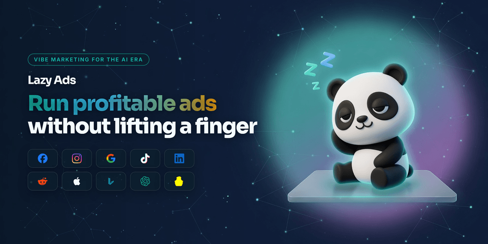

# LazyAds for Hermes (and every other MCP client)



Public listing for the [Lazy Ads](https://lazyads.ai) MCP server, packaged as a
[Hermes Agent](https://hermes-agent.nousresearch.com) plugin.

Connect Hermes, Claude, Cursor and any MCP-compatible client to your ad accounts across Meta
(Facebook + Instagram), Google, TikTok, LinkedIn, Reddit, Apple, Bing, ChatGPT and Snapchat, through one
hosted MCP connection and one API key.

This repository is documentation plus a portable
[Agent Plugins v1](https://agent-plugins.org/specification) package. It does not contain product source
code and ships no executable code: `plugin.json`, `mcp.json` and `skills/lazyads/SKILL.md`.

## Install in Hermes

```bash
hermes plugins install lazyads
hermes config set LAZY_ADS_API_KEY la_your_api_key
hermes plugins enable lazyads
```

The plugin adds two things:

- the hosted **LazyAds MCP server** (`https://mcp.lazyads.ai/mcp`, Streamable HTTP, MCP 2026-07-28), and
- the **`lazyads` skill**, a workflow guide with a spend-safety checklist for the agent.

Create the key at [Settings → API Keys](https://lazyads.ai/dashboard/settings?tab=api) in the Lazy Ads
dashboard (any paid plan: **BYOA** for the bridge, **Starter and above** for the full suite with Lazy Ads
AI), and connect your ad accounts in the same dashboard. Start a new Hermes session, then ask *"Which ad
platforms am I connected to?"* to confirm. Until `LAZY_ADS_API_KEY` is set Hermes refuses to start the server and
names the missing variable; no request is sent.

Installing straight from this repository, without the catalog:

```bash
hermes plugins install camerondwills/lazyads-mcp
```

Prefer no plugin? Use the manual config in `~/.hermes/config.yaml`:

```yaml
mcp_servers:
  lazyads:
    url: "https://mcp.lazyads.ai/mcp"
    headers:
      Authorization: "Bearer ${LAZY_ADS_API_KEY}"
```

## What you can do

- "How did my campaigns do this week?"
- "Pause anything with CPA over 2x my target."
- "Import my live Google campaigns into Lazy Ads with tracking on."
- "Create a Meta sales campaign at $40/day, paused, and show me before it goes live."
- "Build me a Meta campaign for my best seller." (Starter and above)
- "Generate three creative variations for my summer sale and score them." (Starter and above)
- "What ads is a competitor running right now?" (Starter and above)

Bridge mode (39 tools, every paid plan) lets your own agent supply strategy and copy. Full mode (53 tools,
Starter and above) adds 14 Lazy Ads AI tools. Post-create edits (`update_ad`, `update_ad_set`) write Lazy
Ads and the live platform when supported, and fail instead of a silent database-only write. The live
catalog is at [lazyads.ai/mcp](https://lazyads.ai/mcp#tools); workflows are in
[`skills/lazyads/SKILL.md`](skills/lazyads/SKILL.md).

## Disclosure

What this plugin does on your machine and with your data:

- **Network.** Every tool call is an HTTPS request to `mcp.lazyads.ai` (Lazy Ads, which in turn talks to
  the ad platforms you connected in the dashboard). Nothing else is contacted.
- **Credential.** One API key, read from `LAZY_ADS_API_KEY` through Hermes's own `${VAR}` resolution and
  sent as an `Authorization: Bearer` header on each request. The plugin never reads files, keychains or
  other credential stores, and the header is dropped on any cross-origin redirect.
- **Spending.** The tools create and edit real campaigns that spend your ad budget. Hermes does not gate
  them; the bundled skill instructs the agent to confirm platform, objective, budget and targeting with
  you before anything is created, published, un-paused or scaled, and to stay read-only in unattended
  runs. That is an instruction to the model, not an enforcement boundary. To make Hermes ask before every
  write-capable call, set `trust: untrusted` on the `lazyads` server in your `config.yaml`.
- **No local processes.** No shell commands, no background processes, no telemetry, no self-update, no
  files written outside Hermes's own plugin directories.

## Other MCP clients ([lazyads.ai/mcp#setup](https://lazyads.ai/mcp#setup))

- **URL:** `https://mcp.lazyads.ai/mcp`
- **Protocol:** MCP 2026-07-28 Streamable HTTP (stateless: no `initialize`, no `Mcp-Session-Id`)
- **Auth:** API key from Lazy Ads → Settings → API Keys (any paid plan); `X-API-Key` is also accepted

Cursor (`.cursor/mcp.json`) and Claude Code (`.mcp.json`):

```json
{
  "mcpServers": {
    "lazyads": {
      "url": "https://mcp.lazyads.ai/mcp",
      "headers": { "Authorization": "Bearer la_your_api_key" }
    }
  }
}
```

Claude Code one-liner:
`claude mcp add --transport http lazyads https://mcp.lazyads.ai/mcp --header "Authorization: Bearer la_your_api_key"`

Windsurf uses `serverUrl` instead of `url`. Gemini CLI uses `httpUrl`. VS Code uses `servers` with
`"type": "http"`. Codex CLI reads `[mcp_servers.lazyads]` with `url` and
`bearer_token_env_var = "LAZY_ADS_API_KEY"` from `~/.codex/config.toml`. Claude Desktop only launches
local processes, so bridge it with `mcp-remote` and put the header in `env`. Copy-ready blocks for every
client: https://lazyads.ai/mcp#setup

The root [`SKILL.md`](./SKILL.md) is the standalone skill for skills.sh:

```bash
npx skills add camerondwills/lazyads-mcp
```

## Notes

- Per-key rate limits (one-minute window): BYOA 60, Starter 30, Growth 100, Scale 500, Enterprise 1000.
  Bursts return 429 with `Retry-After`.
- LinkedIn and Reddit do not report revenue through their APIs, so ROAS can show 0 there.
- Free accounts can onboard and browse competitor ads. Lazy Ads AI tools require Starter or above. The
  REST API (`https://lazyads.ai/api/v1`) and outbound webhooks require Growth or above.

## Pricing

See [lazyads.ai/pricing](https://lazyads.ai/pricing). Plans: BYOA, Starter, Growth, Scale, Enterprise.
Fixed monthly fee, bring your own ad accounts, not a cut of ad spend.

## Links

- Site: https://lazyads.ai
- MCP docs: https://lazyads.ai/mcp
- Pricing: https://lazyads.ai/pricing
- Hermes: https://lazyads.ai/hermes
- Blog: https://lazyads.ai/blog

## License

Documentation and plugin files in this repo are MIT. Lazy Ads the product remains a separate, private
codebase.
